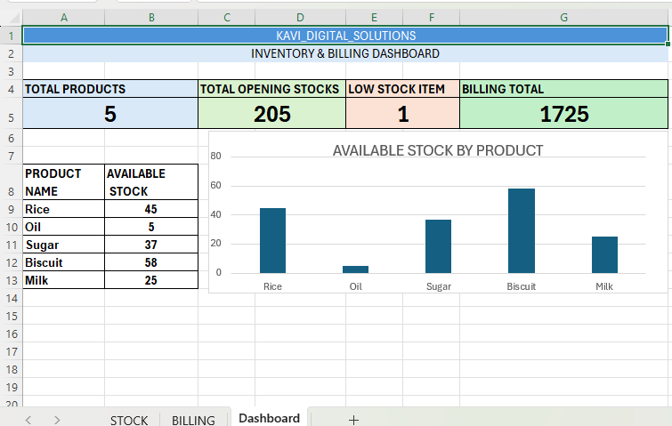

\# Kavi Stock Management System

\## 📌 Project Overview

Kavi Stock Management System is an Excel-based project developed to manage product inventory, billing, and stock availability. It helps track stock levels, calculate bills automatically, and identify low-stock products.

\## 🎯 Features

\- Product inventory management

\- Automatic stock sold calculation

\- Available stock tracking

\- Low stock alerts using conditional formatting

\- Automatic product price lookup

\- Automatic bill total calculation

\- Grand total calculation

\- Inventory dashboard with summary cards and a chart

\## 🛠️ Tools Used

\- Microsoft Excel

\- Excel Formulas

\- VLOOKUP and SUMIF

\- IF and COUNTIF

\- Conditional Formatting

\- Charts and Dashboard Design

\## 📊 Dashboard

The dashboard provides an overview of total products, total opening stock, low-stock items, billing total, and available stock by product.

\## 💡 What I Learned

\- Inventory and billing management using Excel

\- Applying formulas to automate calculations

\- Tracking stock availability

\- Creating a dashboard to summarize business data

